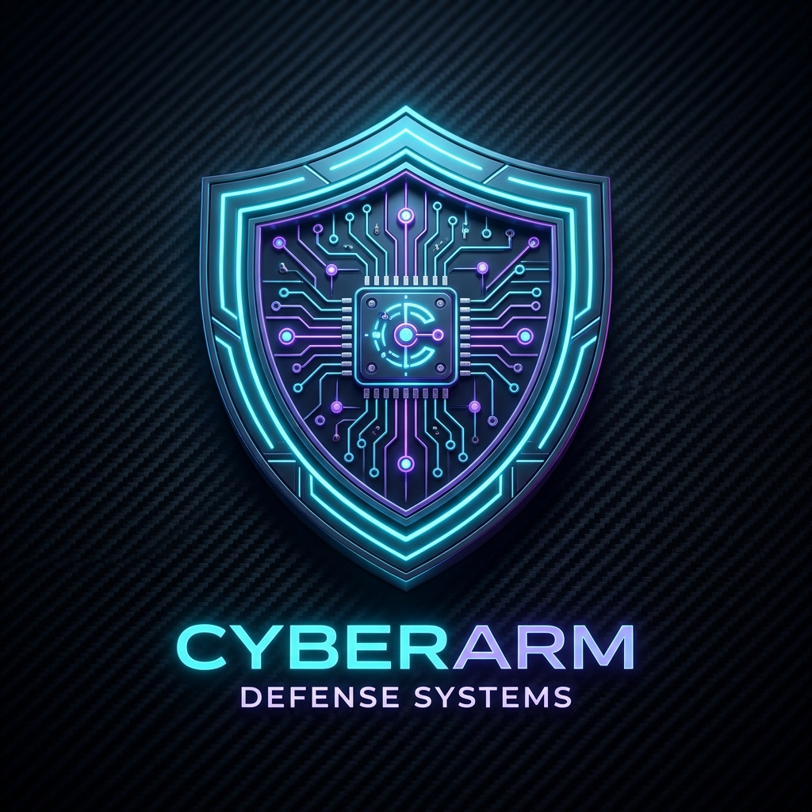

# Security Guard Desktop 🛡️

A high-performance Cyber Defense & Supply-Chain Security Operations Desktop Application built on top of [guard.sh](file:///Users/bdcalling/Desktop/untitled%20folder/guard.sh) and the `guard` cybersecurity engine.



---

## 1. Analysis of `guard.sh`

`guard.sh` is an automated, secure Unix/macOS installer and bootstrapping script for the `guard` security suite (maintained at `https://github.com/Syed-Bipul-Rahman/Security-Guard`).

### Core Actions performed by `guard.sh`:
1. **Architecture & OS Verification**: Detects `Linux` or `Darwin` (macOS) and cpu architecture (`x86_64` or `arm64/Apple Silicon`).
2. **Fail-Closed Cryptographic Check**:
   - Downloads the precompiled binary `guard-<os>-<arch>` from verified GitHub releases.
   - Downloads and checks the SHA-256 hash checksum (`$asset.sha256`).
   - Aborts immediately if the checksum is missing or does not match (`fail-closed` security principle).
3. **Privileged Installation**: Installs verified binary to `/usr/local/bin/guard`.
4. **Daemon Deployment (`guard install`)**: Installs a persistent system service running `guard watch` (an always-on kernel/filesystem watcher).
5. **Git Push/Clone Defense Hooks (`guard hooks install`)**:
   - Installs git hooks into `~/.guard/githooks` and adds them to global git config.
   - Intercepts `pre-push` to scan and block malicious payloads from ever reaching remote git repositories.
   - Automatically scans code arriving via `git clone` and `git pull`.
6. **macOS TCC Privacy Permission Provisioning**: Prompts for required disk read permissions (Desktop, Downloads, Documents).

### Underlying `guard` Capabilities:
- `guard scan <path> [--json]`: Supply chain scanner checking for VS Code configuration exploits (`.vscode/tasks.json` backdoors), malicious GitHub Actions workflows, malicious npm/PyPI dependencies, and file fingerprints.
- `guard scan-git <path>`: Scans git history diffs across all branches to catch backdoors even if deleted in latest commits.
- `guard av scan <path>`: Antivirus scanning engine with YARA rules, hash databases, and heuristics.
- `guard triage`: OS-native Host Incident Response triage (detects reboot persistence, rogue LaunchAgents, daemons, cron jobs).
- `guard clean <path>`: Surgical malware excision that neutralizes threats while preserving safe code.

---

## 2. Desktop Application Architecture

**Security Guard Desktop** transforms the CLI capabilities of `guard` into an interactive graphical defense dashboard with:
- **GitHub Authentication**:
  - Automatically hooks into existing `gh` CLI credentials (keyring) or accepts Personal Access Tokens (`repo` scope).
  - Fetches the user's **complete portfolio of public and private repositories**.
  - Performs automated shallow clone scans in temporary isolated sandboxes with zero leftover artifacts.
- **Local PC Workstation Scanner**:
  - Scans user home (`~`), Desktop, Downloads, Documents, Projects folders, or any custom chosen directory.
  - Supports simultaneous Supply-Chain, Antivirus, and deep Git scanning.
- **AI Security Copilot & Remediation Playbook**:
  - Built-in configuration for **Google Gemini**, **OpenAI**, **Anthropic Claude**, and **Ollama (local/offline)**.
  - Takes raw telemetry findings and produces executive risk scores (CRITICAL / HIGH / MEDIUM / CLEAN), vector analysis, and copy-paste terminal remediation commands.
- **Exportable Audit Reports**:
  - Export full telemetry to JSON or standalone HTML executive reports.

---

## 3. How to Launch

Open terminal in the project directory:

```bash
cd "/Users/bdcalling/Desktop/untitled folder/guard-desktop"
npm start
```

Or run the one-click script:

```bash
./launch.sh
```

---

## 4. Configuration & Keys

Stored securely in `~/.guard/desktop-config.json`:
- **AI Settings**: Provider, API Key, and Model (`gemini-1.5-flash`, `gpt-4o-mini`, `claude-3-5-sonnet`, `llama3`).
- **GitHub Auth**: Custom PAT override or automatic `gh` CLI session.
- **Guard Engine**: Auto-detected binary at `/usr/local/bin/guard`.
